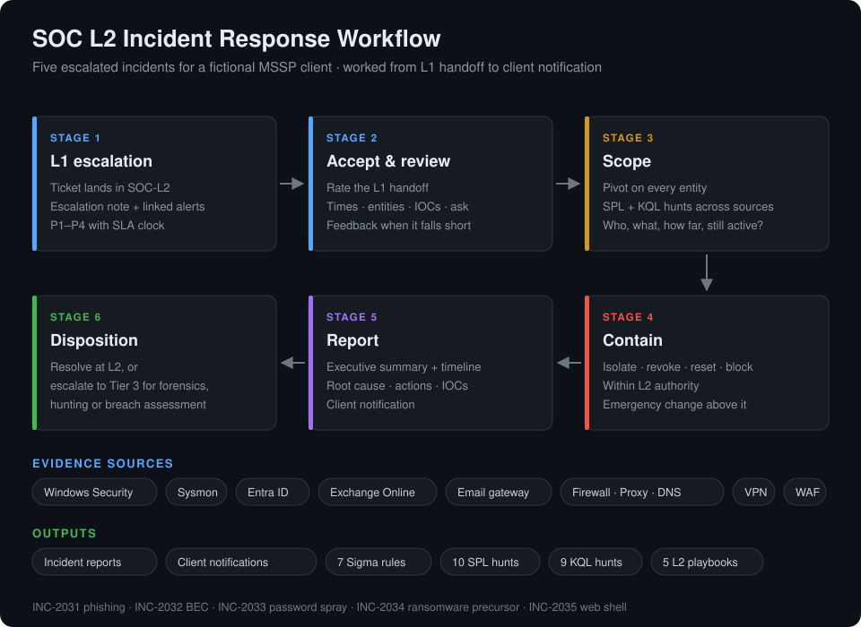
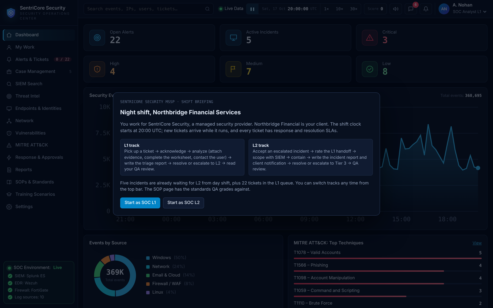
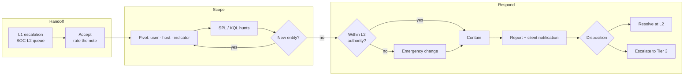

# SOC L2 Incident Response Lab


A hands-on **Tier 2 SOC incident response lab**. I work five incidents escalated by L1 for a fictional managed-security client the way an L2 analyst handles them on shift: review the quality of the L1 handoff, scope the attack from raw Windows, Sysmon, identity, email and network telemetry, contain it within my authority, write the **incident report** and **client notification**, then resolve at L2 or escalate to Tier 3. Each incident also produces **detection content**: seven **Sigma** rules, ten **Splunk** hunts and nine **Microsoft Sentinel KQL** hunts, plus an L2 **playbook** per attack type.

The lab runs on **SentriCore**, a browser-based SOC console that simulates a live night shift: an ITSM ticket queue with response and resolution SLAs, SIEM search, SOAR response actions with tier-based approvals, simulated teammates and QA-graded reports.

> **What it shows:** the parts of the L2 role that go beyond L1 triage: judging whether an escalation is usable, scoping past the first alert, making containment decisions the evidence can justify, and writing for management, auditors and the client. One weak L1 note (`INC-2032`: *"Weird email stuff on k.larsen mailbox… Pls check."*) hid a $480,000 wire-fraud attempt.



## Why I Did This

L1 labs teach you to decide whether an alert is real. The L2 job starts after that decision: how far did the attacker get, what do we contain without taking the business down, and how do we explain it to people who don't read logs. I wanted a lab that forces those decisions under the pressures a real shift has (SLA clocks, a queue that keeps growing, approvals I can't skip) and that grades the written output, not just the verdict.

## Highlights

- **Five escalated incidents:** phishing to credential theft, business email compromise, password spraying, a ransomware precursor and a SQL-injection web shell.
- **Evidence packs:** 162 raw log events across Windows Security, Sysmon, Entra ID, Exchange Online, email gateway, firewall, proxy, DNS, VPN and WAF, with alerts and directory, CMDB and threat-intel context per case.
- **Handoff quality review:** two of the five L1 notes are deliberately weak; rating them and writing feedback is part of the work.
- **Scoping in two SIEMs:** every case documents its hunting queries in **Splunk SPL** and **Microsoft Sentinel KQL**.
- **Containment with authority limits:** actions above L2 (servers, privileged accounts, domain controllers) go through emergency change approval.
- **Three-audience reporting:** executive summary for management, timeline and actions for auditors, plain-language notification for the client.
- **Detection-as-code:** behaviour-based Sigma rules with documented false positives and tuning notes, validated as YAML.
- **Playbooks:** decision flowcharts, minimum containment and Tier 3 escalation criteria for each attack type.
- **Safe data:** RFC 5737 documentation IPs, `example.*` domains and fictional organisations throughout.

## Screenshots

| SOC dashboard | L2 incident queue |
|---|---|
|  |  |

| L1 handoff review on INC-2034 | Scoping a C2 address across hosts |
|---|---|
|  |  |

| Password spray: results per account | Ticket queue with response and resolution SLAs |
|---|---|
|  |  |

| Shift briefing | Team channel during the shift |
|---|---|
|  |  |

## Incident Case Files

| Incident | Attack | Severity | ATT&CK | Evidence | Status |
|---|---|---|---|---|---|
| [INC-2031](cases/INC-2031-phishing-credential-theft/) | Phishing → credential theft → PowerShell | critical · P1 | `T1566.002` `T1078` `T1059.001` | 16 events | 📝 In progress |
| [INC-2032](cases/INC-2032-business-email-compromise/) | Business email compromise, $480k wire attempt | critical · P1 | `T1566` `T1098.002` | 8 events | 📝 In progress |
| [INC-2033](cases/INC-2033-password-spraying/) | Password spraying with three successful logons | high · P1 | `T1110.003` | 70 events | 📝 In progress |
| [INC-2034](cases/INC-2034-ransomware-precursor/) | Ransomware precursor with active C2 | critical · P1 | `T1490` `T1571` | 8 events | 📝 In progress |
| [INC-2035](cases/INC-2035-web-application-compromise/) | SQL injection → web shell on customer portal | critical · P1 | `T1190` `T1505.003` `T1053.005` | 60 events | 📝 In progress |

Each case folder holds the brief, the evidence pack, the hunting queries, the incident report and the client notification.

## Detection Engineering

| Artifact | What it covers |
|---|---|
| [`detections/sigma/`](detections/sigma/) | Password spray, Kerberoasting, recovery inhibition, web shell, Office macro dropper, BEC inbox rules, service-account misuse |
| [`detections/splunk_hunts.spl`](detections/splunk_hunts.spl) | Ten hunts, including spray-to-success correlation and beacon interval analysis |
| [`detections/sentinel_hunts.kql`](detections/sentinel_hunts.kql) | Nine hunts for Sentinel and Defender tables, including MFA fatigue |

Example: the recovery-inhibition rule that fires on INC-2034.

```yaml
detection:
  selection_vss:
    Image|endswith: '\vssadmin.exe'
    CommandLine|contains|all:
      - 'delete'
      - 'shadows'
  selection_wb:
    Image|endswith: '\wbadmin.exe'
    CommandLine|contains: 'delete'
  condition: 1 of selection_*
level: critical
```

See [06 — Detection Engineering](docs/06-detection-engineering.md) for logic, false positives and the testing plan.

## Playbooks

| Playbook | Minimum containment | Escalate to Tier 3 when |
|---|---|---|
| [Credential compromise](playbooks/01-credential-compromise.md) | Revoke sessions, reset password, isolate if code ran | Privileged or service-account credentials are used |
| [Business email compromise](playbooks/02-business-email-compromise.md) | Revoke, remove rules, block look-alike domain, hold the payment | More than one mailbox or any endpoint is involved |
| [Password spraying](playbooks/03-password-spraying.md) | Block source IP, reset every hit account | A hit account shows follow-on activity |
| [Ransomware precursor](playbooks/04-ransomware-precursor.md) | Isolate host, block C2 estate-wide | Always |
| [Web application compromise](playbooks/05-web-application-compromise.md) | Isolate server, block attacker and C2 | Post-exploitation on an internet-facing server |

## Tools & Technologies

- **SentriCore SOC console:** ITSM ticketing with SLAs, SIEM search, SOAR actions with approvals, threat intel, CMDB and team chat ([`simulator/`](simulator/index.html)).
- **Splunk SPL** and **Microsoft Sentinel KQL:** scoping and threat hunting.
- **Sigma:** vendor-neutral detection rules, convertible with `sigma-cli`.
- **MITRE ATT&CK:** technique mapping per incident and coverage by tactic.
- **NIST SP 800-61:** incident handling lifecycle.
- **Windows telemetry:** Security events 4624, 4625, 4648, 4740, 4768, 4769, 4771 and Sysmon 1, 3, 11.
- **Cloud and email telemetry:** Entra ID sign-ins, Exchange Online audit, email gateway.
- **Network telemetry:** firewall, proxy, DNS, VPN and WAF.

## Investigation Flow



## How This Fits a SOC

```text
SIEM / EDR / email alert → L1 triage → true positive, high impact?
    ├─ no  → resolve at L1 (benign, false positive, handled phish)
    └─ yes → escalate to L2
               ├─ review handoff → scope → contain → report → notify client
               ├─ resolved at L2 → lessons learned → new detection / tuning
               └─ escalate to Tier 3 → forensics, malware analysis, breach assessment
```

## Repository Structure

```text
soc-l2-incident-response-lab/
├── README.md
├── LICENSE
├── assets/
│   ├── diagrams/
│   │   └── l2-incident-response-workflow.svg
│   └── screenshots/                 # 8 SentriCore console screenshots
├── cases/
│   ├── INC-2031-phishing-credential-theft/
│   │   ├── README.md                # brief, linked alerts, hunting queries
│   │   ├── report.md                # incident report
│   │   ├── client-notification.md
│   │   └── evidence/
│   │       ├── events.csv           # raw log events (defanged)
│   │       ├── alerts.json          # linked SIEM alerts
│   │       ├── entities.json        # directory, CMDB and intel context
│   │       └── l1-escalation-note.txt
│   ├── INC-2032-business-email-compromise/
│   ├── INC-2033-password-spraying/
│   ├── INC-2034-ransomware-precursor/
│   └── INC-2035-web-application-compromise/
├── detections/
│   ├── README.md                    # rule index, conversion, tuning
│   ├── sigma/                       # 7 Sigma rules
│   ├── splunk_hunts.spl             # 10 Splunk hunts
│   └── sentinel_hunts.kql           # 9 KQL hunts
├── playbooks/                       # 5 L2 playbooks with flowcharts
├── templates/                       # L1 triage, L2 incident, handoff review, client notification
├── docs/
│   ├── 01-lab-overview.md
│   ├── 02-lab-environment.md
│   ├── 03-soc-operating-procedures.md
│   ├── 04-l2-investigation-methodology.md
│   ├── 05-mitre-attack-mapping.md
│   ├── 06-detection-engineering.md
│   ├── 07-qa-rubric-and-report-standards.md
│   └── 08-simulator-guide.md
└── simulator/
    └── index.html                   # SentriCore SOC console (single file)
```

## Project Documentation

| Phase | Document | Focus |
|---|---|---|
| 01 | [Lab Overview](docs/01-lab-overview.md) | Scenario, objectives, scope and methodology |
| 02 | [Lab Environment](docs/02-lab-environment.md) | Network, log sources, data model, assets and identities |
| 03 | [SOC Operating Procedures](docs/03-soc-operating-procedures.md) | L1 and L2 lifecycles, escalation criteria, SLAs, response authority |
| 04 | [L2 Investigation Methodology](docs/04-l2-investigation-methodology.md) | Handoff review, scoping pivots, containment decisions, disposition |
| 05 | [MITRE ATT&CK Mapping](docs/05-mitre-attack-mapping.md) | Techniques per incident, coverage by tactic and gaps |
| 06 | [Detection Engineering](docs/06-detection-engineering.md) | Sigma logic, SIEM hunts, false positives and testing plan |
| 07 | [QA Rubric and Report Standards](docs/07-qa-rubric-and-report-standards.md) | How reports are graded, writing standard, handoff examples |
| 08 | [Simulator Guide](docs/08-simulator-guide.md) | What the SentriCore console simulates and how the cases were worked |

## How to Review

1. **Start with a case:** open [INC-2034](cases/INC-2034-ransomware-precursor/) for the brief, the L1 note and the raw evidence.
2. **Check the method:** [L2 Investigation Methodology](docs/04-l2-investigation-methodology.md) shows how each case was scoped and contained.
3. **Read the output:** each case's `report.md` and `client-notification.md` show the writing for management and the client.
4. **See it operationalized:** [Detection Engineering](docs/06-detection-engineering.md) and [`playbooks/`](playbooks/) show what each incident left behind.

## Skills Demonstrated

- **Incident response:** NIST SP 800-61 lifecycle from escalation to disposition.
- **Escalation quality review:** rating L1 handoffs and giving actionable feedback.
- **Scoping and threat hunting:** pivoting on users, hosts and indicators across identity, endpoint, email and network data.
- **Windows event analysis:** logon, Kerberos, explicit-credential and lockout events; Sysmon process and network telemetry.
- **Identity and email security:** session-token replay, MFA abuse, inbox-rule persistence and BEC.
- **Containment decision-making:** proportional response within delegated authority and change approval.
- **Report writing:** executive summaries, timelines, root cause, recommendations and client notifications.
- **SIEM querying:** Splunk SPL and Microsoft Sentinel KQL.
- **Detection-as-code:** behaviour-based Sigma rules with false-positive and tuning notes.
- **MITRE ATT&CK:** technique mapping and coverage-gap analysis.

## Roadmap

- Complete the incident report and client notification for each case, and record the simulator QA score
- Convert the Sigma rules with `sigma-cli` and test them against the case evidence in Splunk
- Add detections for the tactics with no coverage yet: Discovery, Collection and Exfiltration
- Add an MFA fatigue Sigma rule to match the KQL hunt
- Publish the simulator through GitHub Pages so reviewers can open it from the repository
- Add a timeline diagram for each incident

---

## Disclaimer

This repository was created for cybersecurity education, defensive training and portfolio development. SentriCore Security and Northbridge Financial Services are fictional, and all telemetry is synthetic: IP addresses come from the RFC 5737 documentation ranges or private RFC 1918 space, and domains use `example.net`, `example.com` and `example.org`. No real organisation, production environment or user was targeted.

---

## Author

**Anik Nohan**

This lab was built to practise and demonstrate real-world SOC Tier 2 skills in:

- Incident scoping, containment and disposition
- L1 escalation review and feedback
- Windows, identity, email and network log analysis
- Incident reports and client communication
- Detection engineering with Sigma, Splunk SPL and KQL
- MITRE ATT&CK mapping

Also see my [Splunk SOC Analyst Detection Lab](https://github.com/aniknohan/splunk-soc-analyst-detection-lab), [MISP Phishing Threat Intelligence Lab](https://github.com/aniknohan/misp-phishing-threat-intelligence-lab), [Windows DFIR Security Event Investigation](https://github.com/aniknohan/windows-dfir-security-event-investigation) and [Phishing Email Investigation Portfolio](https://github.com/aniknohan/phishing-email-investigation-soc-portfolio).

### Tools Used

`Splunk` • `Microsoft Sentinel` • `KQL` • `Sigma` • `Sysmon` • `Windows Event Logs` • `Entra ID` • `Exchange Online` • `MITRE ATT&CK` • `NIST SP 800-61` • `GitHub`

## License

Released under the [MIT License](LICENSE).
