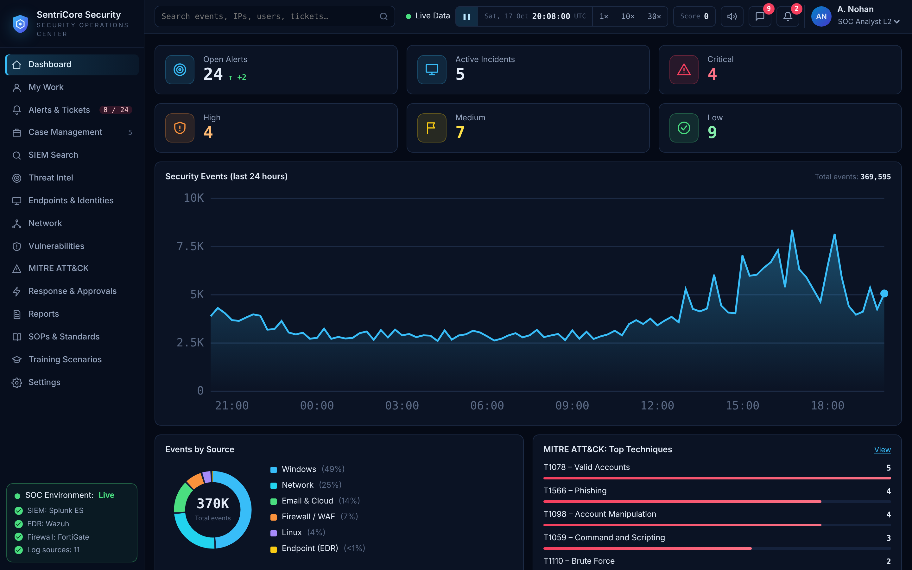
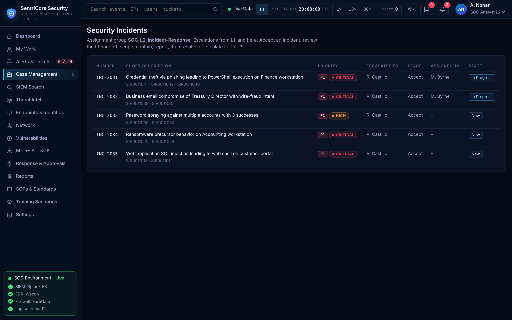
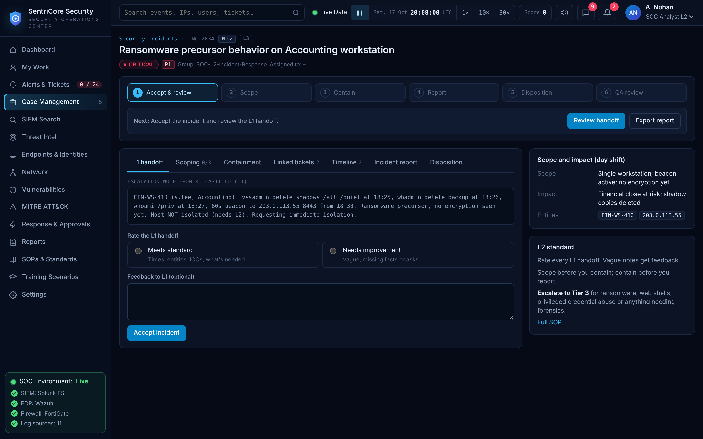
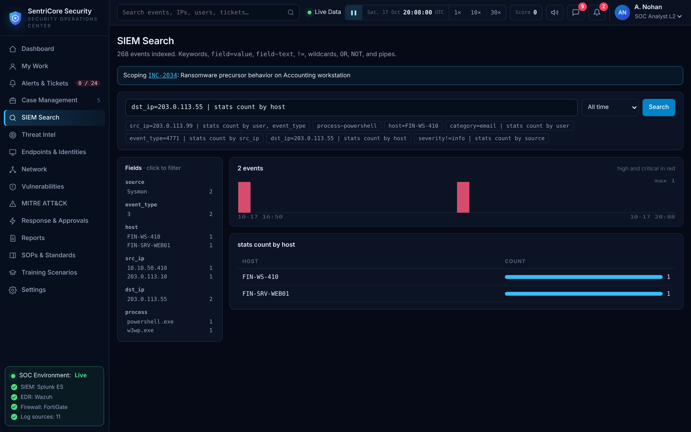
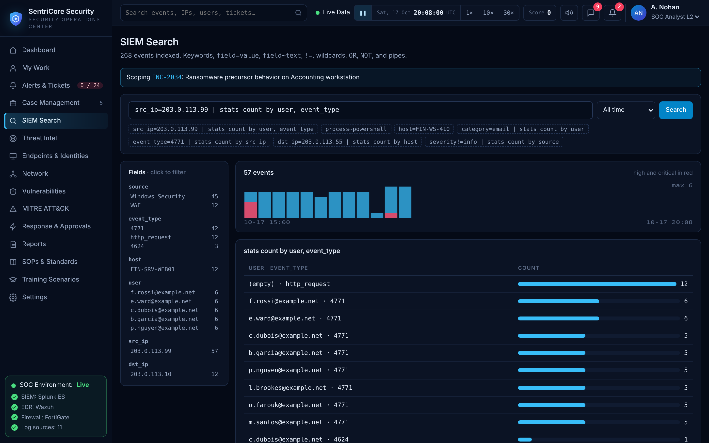
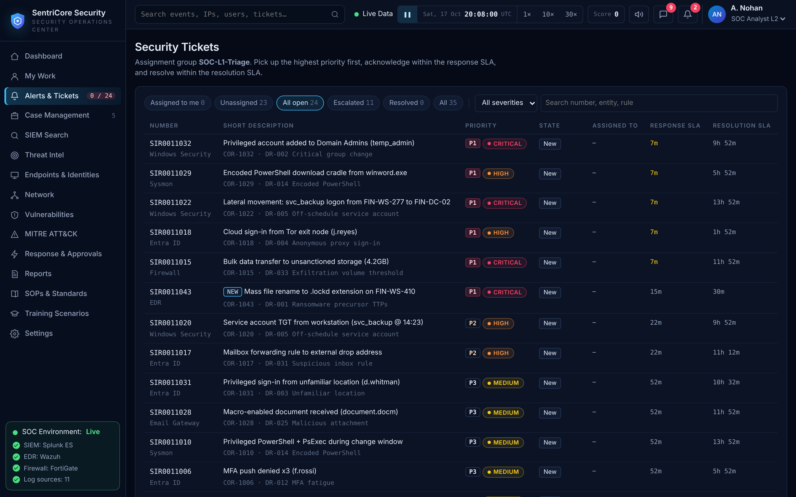
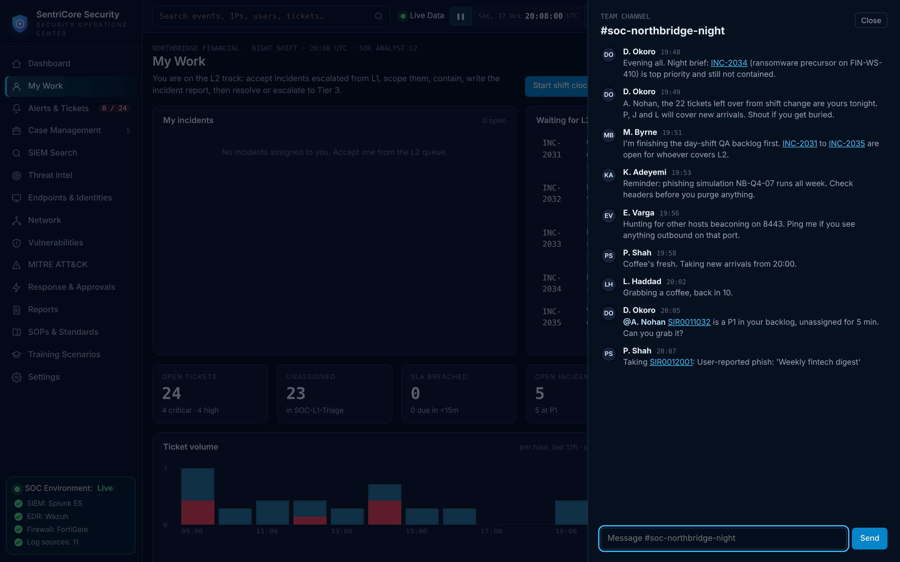
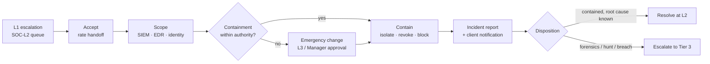

# SOC L2 Incident Response Lab


A hands-on **Tier 2 SOC incident response lab**. I work five escalated incidents for a fictional managed-security client the way an L2 analyst does on shift: review the L1 handoff, scope the attack from raw logs, contain it within my authority, write the incident report and client notification, then resolve or escalate to Tier 3. The lab runs on **SentriCore**, a browser-based SOC console I built that simulates a live night shift: an ITSM ticket queue with SLAs, a SIEM, SOAR response actions with tier approvals, simulated teammates and QA-graded reports.

> **What it shows:** the parts of the L2 job that separate it from L1 triage: judging the quality of an escalation, scoping beyond the first alert, making containment decisions that are justified by evidence, and writing for three audiences (management, auditors and the client).



## Why I Did This

L1 labs teach you to decide whether an alert is real. The L2 job starts after that decision: how far did the attacker get, what do we contain without taking the business down, and how do we explain it to people who don't read logs. I wanted a lab that forces those decisions under the same pressures a real shift has (SLA clocks, a queue that keeps growing, approvals I don't have the authority to skip) and grades the written output, not just the verdict.

## Highlights

- **Five end-to-end incidents:** phishing to credential theft, business email compromise, password spraying, a ransomware precursor and a web application compromise.
- **Real evidence packs:** each case ships the raw log events (Windows Security, Sysmon, Entra ID, Exchange, email gateway, firewall, proxy, WAF), the SIEM alerts, directory and threat-intel context, and the L1 escalation note as received.
- **Handoff review:** two of the five L1 notes are deliberately weak; rating them and giving feedback is part of the job.
- **Scoping queries in two SIEMs:** every case documents the hunting queries in both **Splunk SPL** and **Microsoft Sentinel KQL**.
- **Detection engineering:** seven **Sigma** rules, ten Splunk hunts and nine KQL hunts written from the incidents' behaviour.
- **L2 playbooks:** one per incident type, each with a decision flowchart, minimum containment and Tier 3 escalation criteria.
- **Report standards:** L1 triage, L2 incident report, handoff review and client notification templates, plus the QA rubric the simulator grades against.
- **The lab itself:** the full SentriCore console is in [`simulator/`](simulator/index.html) and runs in any browser.

## Incident Case Files

| Incident | Attack | Severity | ATT&CK | Evidence | Report |
|---|---|---|---|---|---|
| [INC-2031](cases/INC-2031-phishing-credential-theft/) | Phishing → credential theft → PowerShell | critical · P1 | T1566.002, T1078, T1059.001 | 16 events | 📝 In progress |
| [INC-2032](cases/INC-2032-business-email-compromise/) | Business email compromise, $480k wire fraud attempt | critical · P1 | T1098.002, T1566 | 8 events | 📝 In progress |
| [INC-2033](cases/INC-2033-password-spraying/) | Password spraying with three successful logons | high · P1 | T1110.003 | 70 events | 📝 In progress |
| [INC-2034](cases/INC-2034-ransomware-precursor/) | Ransomware precursor with active C2 | critical · P1 | T1490, T1571 | 8 events | 📝 In progress |
| [INC-2035](cases/INC-2035-web-application-compromise/) | SQL injection → web shell on customer portal | critical · P1 | T1190, T1505.003, T1053.005 | 60 events | 📝 In progress |

Each case folder contains a brief, the evidence pack, the hunting queries, my [incident report](templates/l2-incident-report.md) and my client notification.

## Screenshots

| Incident queue with escalation stages | L1 handoff review on INC-2034 |
|---|---|
|  |  |

| Scoping a C2 address across hosts | Password spray: successes per account |
|---|---|
|  |  |

| Ticket queue with response and resolution SLAs | Team channel during the shift |
|---|---|
|  |  |

## L2 Workflow



## Detection Engineering

| Artifact | What it covers |
|---|---|
| [`detections/sigma/`](detections/sigma/) | Seven rules: password spray, Kerberoasting, recovery inhibition, web shell, Office macro dropper, BEC inbox rules, service-account misuse |
| [`detections/splunk_hunts.spl`](detections/splunk_hunts.spl) | Ten hunts including spray-to-success correlation and beacon interval analysis |
| [`detections/sentinel_hunts.kql`](detections/sentinel_hunts.kql) | Nine hunts for Sentinel and Defender tables, including MFA fatigue |

See the [detections README](detections/README.md) for the rule index, conversion commands and tuning notes.

## Playbooks

| Playbook | Escalate to Tier 3 when |
|---|---|
| [Credential compromise](playbooks/01-credential-compromise.md) | Privileged or service account credentials are used |
| [Business email compromise](playbooks/02-business-email-compromise.md) | More than one mailbox or any endpoint is involved |
| [Password spraying](playbooks/03-password-spraying.md) | A hit account shows follow-on activity |
| [Ransomware precursor](playbooks/04-ransomware-precursor.md) | Always |
| [Web application compromise](playbooks/05-web-application-compromise.md) | Post-exploitation is confirmed on an internet-facing server |

## Tools & Technologies

- **SentriCore SOC console:** ITSM ticketing with SLAs, SIEM search, SOAR actions with approvals, threat intel, CMDB, team chat ([`simulator/`](simulator/index.html), [docs](docs/simulator.md)).
- **Splunk SPL** and **Microsoft Sentinel KQL:** scoping and hunting queries.
- **Sigma:** vendor-neutral detection rules, convertible with `sigma-cli`.
- **MITRE ATT&CK:** technique mapping for every incident.
- **NIST SP 800-61:** incident handling lifecycle.
- **Log sources:** Windows Security (4624, 4625, 4648, 4740, 4769, 4771), Sysmon (1, 3, 11), Entra ID sign-ins, Exchange Online audit, email gateway, firewall, proxy, DNS, VPN, WAF.

## How This Fits a SOC

```text
L1 triage ──escalate──▶ L2 incident response ──escalate──▶ L3 forensics / IR
   │                        │
   │ verdict                ├─ scope: who, what, how far, still active?
   │ evidence               ├─ contain: within authority, approvals above it
   │ triage report          ├─ report: executive · timeline · root cause · client
   ▼                        └─ improve: new detection, tuning, control gap
resolve                         ▼
                            resolve at L2
```

## Repository Structure

```text
cases/          five incident folders: brief, evidence/, report, client notification
detections/     Sigma rules, Splunk and KQL hunts
playbooks/      L2 playbooks with decision flowcharts
templates/      L1 triage, L2 incident, handoff review, client notification
docs/           environment and data model, SOPs, QA rubric, simulator guide
simulator/      the SentriCore SOC console (single HTML file)
assets/         screenshots
```

## Disclaimer

SentriCore Security and Northbridge Financial Services are fictional. All IP addresses use the RFC 5737 documentation ranges or private RFC 1918 space, and all domains use `example.net`, `example.com` or `example.org`. Any resemblance to real organisations, people or infrastructure is coincidental. This is a lab, not production incident data.

## License

[MIT](LICENSE)
