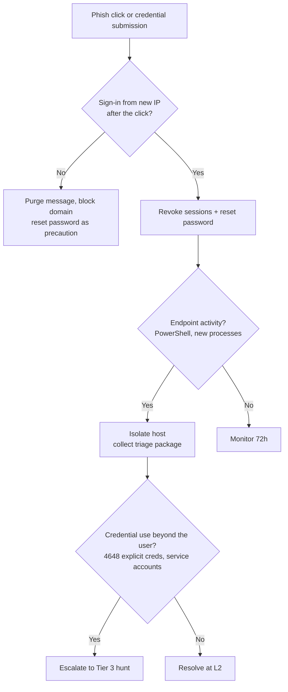

# Playbook: Credential Compromise (Phishing to Account Use)

**Used in:** [INC-2031](../cases/INC-2031-phishing-credential-theft/) · **ATT&CK:** T1566.002, T1078, T1059.001

## Steps

1. **Confirm the click.** Email gateway: URL click and form-submit events for the user; proxy logs for the phishing domain.
2. **Check sign-ins after the click.** Entra ID sign-ins from new IPs or ASNs; note whether MFA was satisfied (push approved by the victim is common).
3. **Check the endpoint.** Sysmon EventID 1 and 3 on the user's host: encoded PowerShell, unusual parents, outbound connections.
4. **Check credential spread.** Windows 4648 (explicit credentials) and 4624 type 3 from the host; any service or admin account use is an escalation trigger.
5. **Contain.** Revoke sessions, force reset, isolate the host if anything ran, block the phishing domain and attacker IP, purge the message from all mailboxes.
6. **Scope recipients.** Search `category=email` for every recipient of the same message and repeat the click check for each.

## Minimum containment

- [ ] Revoke sessions and reset password
- [ ] Isolate the workstation if code executed
- [ ] Block phishing domain and attacker IP
- [ ] Purge the message estate-wide

## Escalate to Tier 3 when

Explicit credential use for a privileged or service account, or execution on more than one host.

## Report checklist

- [ ] Executive summary in plain language
- [ ] Timeline with UTC times, initial access to containment
- [ ] Scope: every user, host and data set
- [ ] Root cause and the control gap
- [ ] Actions taken and who approved them
- [ ] Recommendations with an owner
- [ ] Client notification sent
