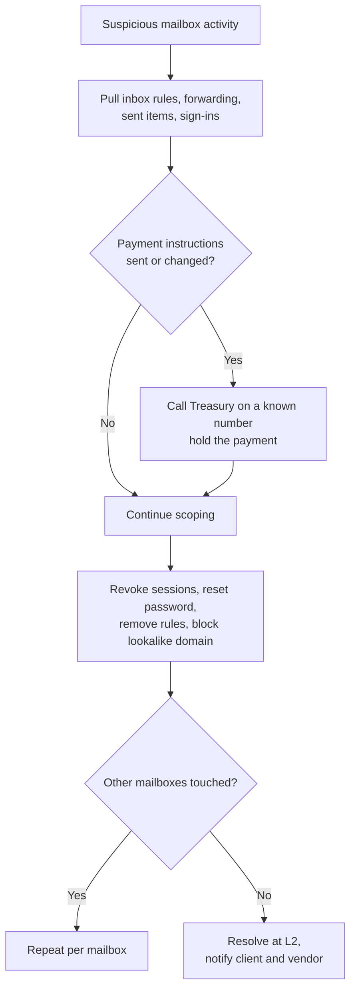

# Playbook: Business Email Compromise

**Used in:** [INC-2032](../cases/INC-2032-business-email-compromise/) · **ATT&CK:** T1078.004, T1098.002, T1566

## Steps

1. **Freeze the money first.** If wire or payment details changed, call Treasury on a number from the directory, never from the email.
2. **List mailbox changes.** `New-InboxRule`/`Set-InboxRule`, forwarding settings, delegates and app consents.
3. **Find the access path.** Sign-ins and token reuse: IP, ASN, user agent; look for session-token replay without a fresh MFA.
4. **Review sent mail.** Outbound mail to lookalike vendor domains; collect message IDs for the client.
5. **Contain.** Revoke sessions, reset password, remove malicious rules, block the lookalike domain and replay IP.
6. **Notify.** Client security contact, Treasury, and the real vendor through a verified contact.

## Minimum containment

- [ ] Revoke sessions and reset password
- [ ] Remove inbox rules and forwarding
- [ ] Block lookalike domain and replay IP
- [ ] Hold or recall the payment

## Escalate to Tier 3 when

Evidence of endpoint compromise or more than one mailbox affected.

## Report checklist

- [ ] Executive summary in plain language
- [ ] Timeline with UTC times, initial access to containment
- [ ] Scope: every user, host and data set
- [ ] Root cause and the control gap
- [ ] Actions taken and who approved them
- [ ] Recommendations with an owner
- [ ] Client notification sent
