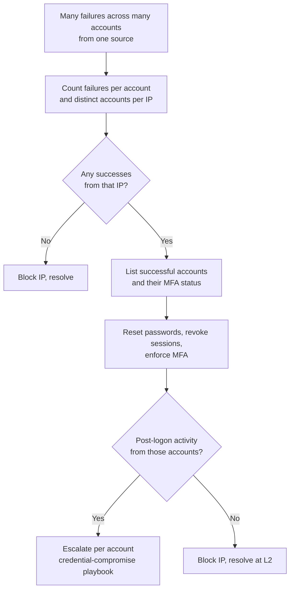

# Playbook: Password Spraying

**Used in:** [INC-2033](../cases/INC-2033-password-spraying/) · **ATT&CK:** T1110.003

## Steps

1. **Confirm the pattern.** Kerberos 4771 (or Entra failures) from one IP across many accounts, few attempts each.
2. **Find the hits.** 4624 successes from the same IP; these are the compromised accounts.
3. **Check MFA.** Accounts without MFA are the reason the spray worked; record it as the root cause.
4. **Check post-logon activity.** Mailbox, file share and VPN activity from each hit account.
5. **Contain.** Block the IP at the edge; reset and revoke for each hit account; push MFA enrolment.

## Minimum containment

- [ ] Block the spraying IP
- [ ] Reset passwords for every account that signed in
- [ ] Enforce MFA on those accounts

## Escalate to Tier 3 when

Any successful account shows follow-on activity such as mailbox access or lateral movement.

## Report checklist

- [ ] Executive summary in plain language
- [ ] Timeline with UTC times, initial access to containment
- [ ] Scope: every user, host and data set
- [ ] Root cause and the control gap
- [ ] Actions taken and who approved them
- [ ] Recommendations with an owner
- [ ] Client notification sent
