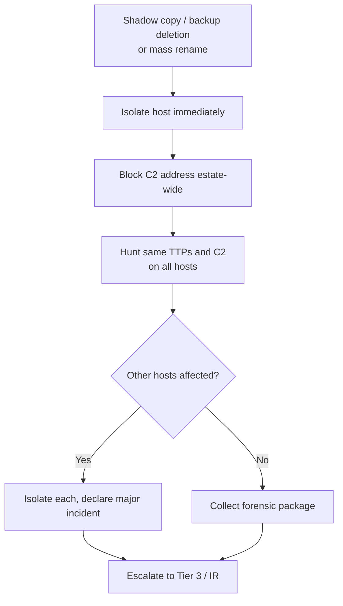

# Playbook: Ransomware Precursor

**Used in:** [INC-2034](../cases/INC-2034-ransomware-precursor/) · **ATT&CK:** T1490, T1486, T1571, T1059.001

## Steps

1. **Isolate first.** `vssadmin delete shadows` or `wbadmin delete backup` means encryption is minutes away. Isolate, then investigate.
2. **Block C2.** Block the beacon destination at the firewall and proxy for every host.
3. **Hunt.** Search the C2 IP, the recovery-inhibition commands and the dropped binary across the estate.
4. **Preserve.** Request a forensic package (memory and triage) before anyone reimages.
5. **Escalate.** Ransomware is always a Tier 3 / IR engagement; the SOC Manager runs the bridge.

## Minimum containment

- [ ] Isolate every affected host
- [ ] Block C2 infrastructure
- [ ] Collect forensics before reimaging

## Escalate to Tier 3 when

Always. Ransomware goes to Tier 3 / incident response.

## Report checklist

- [ ] Executive summary in plain language
- [ ] Timeline with UTC times, initial access to containment
- [ ] Scope: every user, host and data set
- [ ] Root cause and the control gap
- [ ] Actions taken and who approved them
- [ ] Recommendations with an owner
- [ ] Client notification sent
