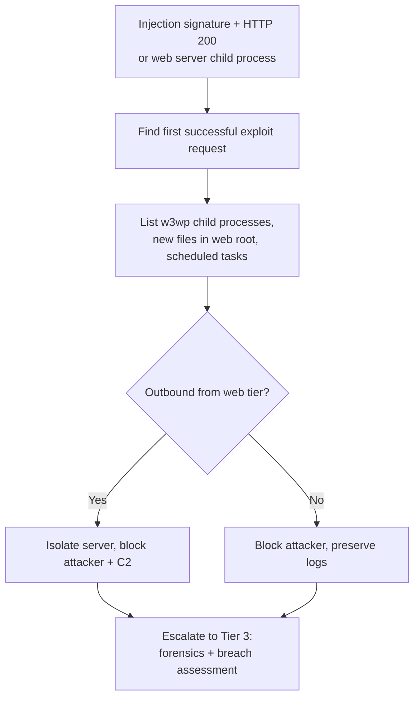

# Playbook: Web Application Compromise

**Used in:** [INC-2035](../cases/INC-2035-web-application-compromise/) · **ATT&CK:** T1190, T1505.003, T1053.005

## Steps

1. **Find the first success.** WAF and web logs: the request that returned 200 among the blocked attempts.
2. **Check post-exploitation.** Children of `w3wp.exe`, new `.aspx` files, scheduled tasks, outbound connections from the server.
3. **Contain.** Isolate the server (Tier 3 authority), block the attacker and any C2 address.
4. **Assess data exposure.** The portal holds customer PII; Tier 3 and Legal decide on breach notification.
5. **Preserve.** Web root, IIS logs and memory before the application team rebuilds.

## Minimum containment

- [ ] Isolate the web server
- [ ] Block attacker and C2 addresses
- [ ] Preserve web logs and web root

## Escalate to Tier 3 when

Always when post-exploitation is confirmed on an internet-facing server holding customer data.

## Report checklist

- [ ] Executive summary in plain language
- [ ] Timeline with UTC times, initial access to containment
- [ ] Scope: every user, host and data set
- [ ] Root cause and the control gap
- [ ] Actions taken and who approved them
- [ ] Recommendations with an owner
- [ ] Client notification sent
